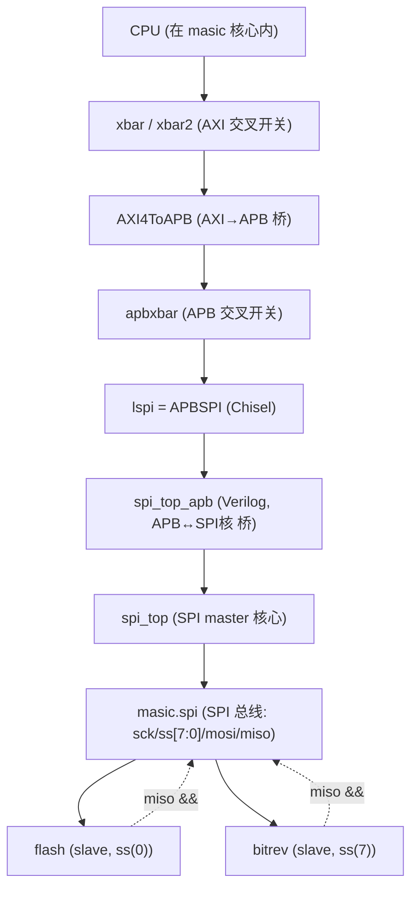
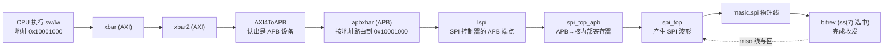
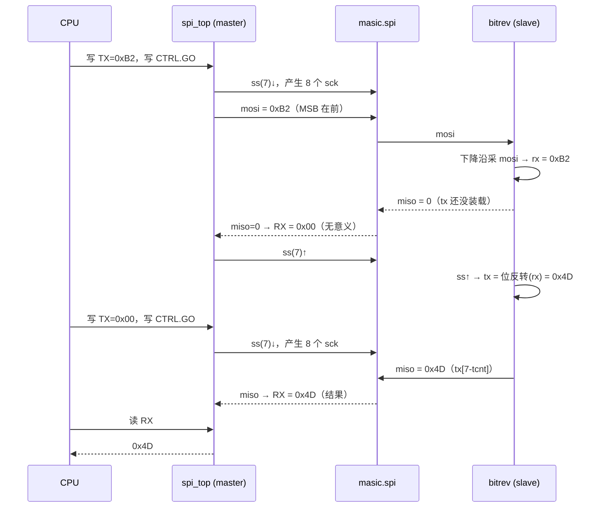

# SPI bitrev 测试（spi-tests）

通过驱动 SoC 内的 **SPI master（`spi_top`）** 与自定义 SPI 从设备 **`bitrev`** 通信，
验证 bitrev 的"8 位输入 → 位翻转 → 8 位输出"是否正确。

## 1. 目录结构

```
spi-tests/
├── Makefile        # AM 构建入口（NAME/SRCS/include $(AM_HOME)/Makefile）
├── spi-bitrev.c    # 测试程序
└── README.md       # 本文档
```

## 2. 构建与运行

```bash
# 前置 1：ysyxSoC 已用 make verilog 重生（去掉 spi_top_apb.v 的 FAST_FLASH 宏）
# 前置 2：跑这个 I/O 测试时关掉 CONFIG_DIFFTEST（读设备的值 NEMU 参考模型没有）
cd /home/wang/ysyx-workbench/am-kernels/tests/spi-tests
make ARCH=riscv32e-ysyxsoc run
```

`make run` 把 `spi-bitrev.c` 编成 flash 镜像 `build/spi-bitrev-riscv32e-ysyxsoc.bin`，
再 `make -C npc/soc run IMG=...bin` 加载进 ysyxSoCFull 运行。
终端会打印 `in=B2 exp=4D got=...` 和结尾的 `0`（过）/`F`（挂）。

## 3. 组件层级图

`lspi` ⊃ `spi_top_apb` ⊃ `spi_top` 是**同一个 master 设备的三层包装**；
`flash` 和 `bitrev` 是挂在 master 引出的 SPI 总线上的两个独立 slave 芯片。



## 4. CPU 指令路由图（从取到访问 SPI 到最底层）



要点：地址解码是**布线时写死**的，不是运行时"发现"；`lspi` 就是"被发现的那個 SPI 设备端点"。

## 5. SPI 传输与返回通路（逐周期 / 两次传输）

SPI 是全双工的：一次传输里 master 同时**发 TX→mosi** 和**收 miso→RX**。
bitrev 的"翻转装载"发生在 `ss` 上升沿（滞后一拍），所以测试要做**两次传输**：
第一次喂数据进去，第二次把结果读出来。



## 6. 带代码的详细过程

### 第 0 步：顶层接线（master 的 SPI 总线连到 bitrev）

`SoC.scala:135-141`：master 的 SPI 引脚叫 `masic.spi`，顶层把它和 `bitrev`、`flash` 连在一起。
`bitrev.io.ss := masic.spi.ss(7)` 只用第 7 根片选选中 bitrev；`miso` 是线与（开漏）。

```135:141:ysyx-workbench/ysyxSoC/src/SoC.scala
    val flash = Module(new flash)
    flash.io <> masic.spi
    flash.io.ss := masic.spi.ss(0)
    val bitrev = Module(new bitrev)
    bitrev.io <> masic.spi
    bitrev.io.ss := masic.spi.ss(7)
    masic.spi.miso := List(bitrev.io, flash.io).map(_.miso).reduce(_&&_)
```

### 第 1 步：地址与寄存器位定义

寄存器索引 = 地址低 5 位取 `[4:2]`（`spi_defines.v:126`）；`0x00`=TX/RX、`0x10`=CTRL、
`0x14`=DIVIDER、`0x18`=SS。CTRL 位：`ASS=13`、`GO=8`、`CHAR_LEN=6:0` 等。

```126:126:ysyx-workbench/ysyxSoC/perip/spi/rtl/spi_defines.v
`define SPI_OFS_BITS           4:2
```

```151:158:ysyx-workbench/ysyxSoC/perip/spi/rtl/spi_defines.v
`define SPI_CTRL_ASS            13
`define SPI_CTRL_IE             12
`define SPI_CTRL_LSB            11
`define SPI_CTRL_TX_NEGEDGE     10
`define SPI_CTRL_RX_NEGEDGE     9
`define SPI_CTRL_GO             8
`define SPI_CTRL_RES_1          7
`define SPI_CTRL_CHAR_LEN       6:0
```

测试写 `CTRL = (1<<13 | 1<<8 | 7)` = `ASS=1, GO=1, CHAR_LEN=7` → 自动片选 + 启动 + 传 8 位。

### 第 2 步：APB 写怎么进到 SPI 核

`lspi` 内部例化的 `spi_top_apb` 把 APB 周期翻译成 SPI 核的 wishbone 接口，并直接例化 `spi_top`。
`.wb_adr_i(in_paddr[4:0])`（`:54`）把地址低 5 位送进核 → 写 `0x10001000` 落到 TX，写 `0x10001010` 落到 CTRL。

```51:69:ysyx-workbench/ysyxSoC/perip/spi/rtl/spi_top_apb.v
spi_top u0_spi_top (
  .wb_clk_i(clock),
  .wb_rst_i(reset),
  .wb_adr_i(in_paddr[4:0]),
  .wb_dat_i(in_pwdata),
  .wb_dat_o(in_prdata),
  .wb_sel_i(in_pstrb),
  .wb_we_i (in_pwrite),
  .wb_stb_i(in_psel),
  .wb_cyc_i(in_penable),
  .wb_ack_o(in_pready),
  .wb_err_o(in_pslverr),
  .wb_int_o(spi_irq_out),

  .ss_pad_o(spi_ss),
  .sclk_pad_o(spi_sck),
  .mosi_pad_o(spi_mosi),
  .miso_pad_i(spi_miso)
);
```

> 注意：`spi_top_apb.v:3` 的 `` `define FAST_FLASH `` 必须删掉，否则走假 flash 旁路，
> `spi_sck/spi_ss` 被强制为 0，bitrev 永远收不到波形。

### 第 3 步：移位引擎 spi_shift（位怎么上/下线）

默认 `TX_NEGEDGE=0, RX_NEGEDGE=0` → `tx_clk`/`rx_clk` 都等于**上升沿**：
master 在 sck 上升沿移出 `mosi`、也在上升沿采样 `miso`。

```87:88:ysyx-workbench/ysyxSoC/perip/spi/rtl/spi_shift.v
  assign rx_clk = (rx_negedge ? neg_edge : pos_edge) && (!last || s_clk);
  assign tx_clk = (tx_negedge ? neg_edge : pos_edge) && !last;
```

发数据（驱动 mosi）：

```121:121:ysyx-workbench/ysyxSoC/perip/spi/rtl/spi_shift.v
      s_out <= #Tp (tx_clk || !tip) ? data[tx_bit_pos[`SPI_CHAR_LEN_BITS-1:0]] : s_out;
```

收数据（采样 miso 进 data）：

```233:233:ysyx-workbench/ysyxSoC/perip/spi/rtl/spi_shift.v
      data[rx_bit_pos[`SPI_CHAR_LEN_BITS-1:0]] <= #Tp rx_clk ? s_in : data[rx_bit_pos[`SPI_CHAR_LEN_BITS-1:0]];
```

`go=1` 时 `tip` 拉高（传输进行中）；8 拍后 `cnt` 到 0、`last=1`，上升沿 `tip` 拉低，
`GO` 位被硬件自动清 0（程序 `while(REG_CTRL & (1<<8))` 因此退出）。

```109:112:ysyx-workbench/ysyxSoC/perip/spi/rtl/spi_shift.v
  else if(go && ~tip)
    tip <= #Tp 1'b1;
  else if(tip && last && pos_edge)
    tip <= #Tp 1'b0;
```

### 第 4 步：bitrev 从设备怎么响应

`reset` 直接绑 `ss`：ss 高=复位/空闲，ss 低=被选中工作。

```7:7:ysyx-workbench/ysyxSoC/perip/bitrev/bitrev.v
    wire reset = ss;
```

每个 `sck` **下降沿**采 `mosi` 进 `rx`（左移，MSB 在前），8 拍后 `rx` = 收到的字节：

```17:27:ysyx-workbench/ysyxSoC/perip/bitrev/bitrev.v
  always @(negedge sck or posedge reset) begin
    if (reset) begin
      cnt   <= 3'd0;
      rx    <= 8'h00;
      tcnt  <= 3'd0;
    end else begin
      rx   <= {rx[6:0], mosi};
      cnt  <= cnt + 3'd1;
      tcnt  <= tcnt + 3'd1;
    end
  end
```

**关键：片选上升沿把收到的字节位翻转锁进 `tx`**：

```29:32:ysyx-workbench/ysyxSoC/perip/bitrev/bitrev.v
  // 装载: ss 上升沿 = 传输结束, rx 已完整 —— 位翻转
  always @(posedge reset) begin
    tx <= {rx[0], rx[1], rx[2], rx[3], rx[4], rx[5], rx[6], rx[7]};
  end
```

回传：每个 `sck` **下降沿**换一位，空闲高：

```34:35:ysyx-workbench/ysyxSoC/perip/bitrev/bitrev.v
  // MISO: 空闲高电平; 传输中按指针送出翻转字节
  assign miso = reset ? 1'b1 : tx[3'd7 - tcnt];
```

### 第 5 步：传输 1（发 0xB2，读回无意义）

`0xB2 = 1011_0010`。master 上升沿移 `mosi`，bitrev 下降沿采 `mosi`；master 上升沿采 `miso`，
bitrev 此时 `tx` 还没装载（=0），`miso` 恒 0。

| sck 拍 | master 上升沿移出 mosi | bitrev 下降沿采 mosi→rx | master 采到的 miso |
|---|---|---|---|
| 1 | `1` | `1` | `0` |
| 2 | `0` | `10` | `0` |
| 3 | `1` | `101` | `0` |
| 4 | `1` | `1011` | `0` |
| 5 | `0` | `10110` | `0` |
| 6 | `0` | `101100` | `0` |
| 7 | `1` | `1011001` | `0` |
| 8 | `0` | `10110010`(=0xB2) | `0` |

8 拍后 master `RX = 0x00`。**传输结束 `ss(7)` 拉高** → 触发 `bitrev.v:30-32` 的 `posedge reset`
→ `tx = 位反转(rx) = 位反转(0xB2) = 0x4D`。此时 master 的 RX 已是 0x00，所以第一次读"没意义"。

### 第 6 步：传输 2（发哑元 0x00，读回 0x4D）

`ss(7)` 再次拉低，8 个 sck。bitrev 的 `tx` 已是 `0x4D`，每个 `sck` 下降沿驱 `miso = tx[7-tcnt]`：

| sck 拍 | bitrev 下降沿驱 miso（tx=0x4D=01001101） | master 上升沿采 miso | 累计 RX |
|---|---|---|---|
| 1 | `tx[7]=0` | `0` | `0` |
| 2 | `tx[6]=1` | `1` | `01` |
| 3 | `tx[5]=0` | `0` | `010` |
| 4 | `tx[4]=0` | `0` | `0100` |
| 5 | `tx[3]=1` | `1` | `01001` |
| 6 | `tx[2]=1` | `1` | `010011` |
| 7 | `tx[1]=0` | `0` | `0100110` |
| 8 | `tx[0]=1` | `1` | `01001101`=0x4D |

8 拍后 master `RX = 0x4D`。`ss(7)` 拉高 → `tip` 清 0 → `GO` 自动清 0 → 轮询退出。

### 第 7 步：数据经"线与"回到 master，CPU 读回

传输中 `flash` 没被选中（`ss(0)` 高），`miso` 驱动高。于是（`SoC.scala:141`）：

```141:141:ysyx-workbench/ysyxSoC/src/SoC.scala
    masic.spi.miso := List(bitrev.io, flash.io).map(_.miso).reduce(_&&_)
```

`bitrev.miso && flash.miso = bitrev.miso && 1 = bitrev.miso`，master 采到的就是 bitrev 回传的 `0x4D`。
CPU 执行 `lw 0x10001000` → 反向走第 2 步通路读出 `RX` → `got = 0x4D == reverse8(0xB2)` → `return 0`。

## 7. 为什么默认边沿无冲突

- master 移/采都在**上升沿**（`spi_shift.v:87-88`，`TX_NEGEDGE/RX_NEGEDGE=0`）。
- bitrev 采 `mosi`、驱 `miso` 都在**下降沿**（`bitrev.v:17,35`）。

两者错开半拍：master 上升沿改变 `mosi` → bitrev 下降沿（数据已稳定）采样；
bitrev 下降沿改变 `miso` → master 上升沿（数据已稳定）采样。**无建立/保持冲突**，
所以测试保持 `TX_NEGEDGE/RX_NEGEDGE=0` 即可，不用改。
